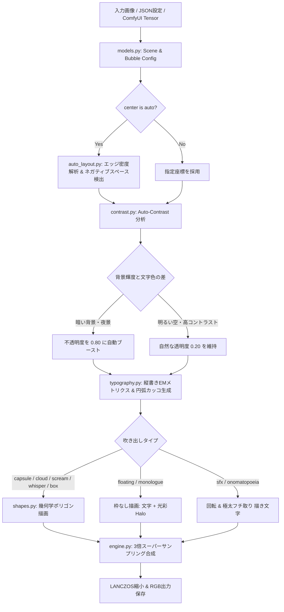

# 💬 Comic Bubble Maker (漫画吹き出し・浮遊モノローグ・オノマトペ合成エンジン)

[](https://www.python.org/)
[](LICENSE)
[](output/verification_report.json)
[]()
[](comfyui_node.py)

ComfyUIやAI生成されたイラスト・漫画画像に対し、**キャラクターへの被りゼロ**・**縦書き組版**・**枠なし浮遊モノローグ**・**漫画オノマトペ**・**叫び＆囁き吹き出し**・**夜景自動コントラスト保護**を備えたプロフェッショナルな漫画吹き出し合成エンジンです。

---

## ✨ 主な特長 (Key Features)

1. **縦書き組版＆文字重なり完全解消 (Vertical Japanese Typography)**
   - インク幅（bbox）ではなくフォントEMサイズ基準の正確な送り幅（Advance）を計算。小文字（「っ」「ょ」）や記号（「…」）の重なりを数理的に完全排除。
   - 縦丸カッコ `（ ）` はUnicode文字未収録による豆腐（□）化を避けるため、数理円弧（`draw.arc`）による直接ベクター描画を実装。
   - `<big>`, `<small>`, `<huge>`, `<tiny>` などのインライン文字拡大縮小タグに対応。

2. **枠なし浮遊モノローグ (`type: "floating"` / `"monologue"`)**
   - 登場人物の「心の声」や情緒的な独白向けに、**吹き出し枠を一切描かず、文字のみを風景に溶け込ませて漂わせる**モードを完備。
   - 夕暮れや夜の街灯に合わせた光彩（Halo）を纏わせることで、背景の美しさを100%残したまま高い可読性を維持。

3. **漫画オノマトペ・描き文字 (`type: "sfx"` / `"onomatopoeia"`)**
   - `ドキッ`, `ドンッ`, `ゴゴゴ…` などの迫力ある擬音・効果音をサポート。
   - 角度回転（`angle: -14.0`）や多重フチ取り（`stroke_width`, `stroke_color`）によるプロ漫画レベルの表現が可能。

4. **多彩な漫画吹き出し形状 (Rich Balloon Geometry)**
   - **通常カプセル (`capsule`)**: 最も文字が綺麗に収まる角丸スーパー楕円。
   - **モコモコ雲型 (`cloud`)**: 感情の高まりや思考表現。
   - **叫び・爆発 (`scream` / `burst`)**: 驚き・激昂・叫び用のウニフラ星型ポリゴンとしっぽ。
   - **囁き・ヒソヒソ (`whisper`)**: 点線・破線による小声表現。
   - **スクエア枠 (`box`)**: 漫画の四角いナレーション・モノローグ枠。

5. **夜景・暗所での自動コントラスト判定 (Auto-Contrast Engine)**
   - 吹き出し配置領域の背景輝度（Rec. 601）をリアルタイムにサンプリング。
   - 夜景や濃い影の上に配置された場合、透明度を `0.20 → 0.80` へ自動引き上げ、文字の埋没を完全に防止。

6. **ネガティブスペース自動探索 (Smart Auto-Placement)**
   - `center: "auto"` を指定すると、輪郭・エッジ密度解析によりキャラクター（顔・身体）を自動検出し、空や背景などの安全な余白領域へ自動配置。

7. **ComfyUI ネイティブカスタムノード対応 (`comfyui_node.py`)**
   - 本リポジトリをそのまま `ComfyUI/custom_nodes/` に配置するだけで、ComfyUIワークフロー内で `💬 Manga Speech Bubble & SFX` ノードとして即座に利用可能。

8. **マルチプラットフォーム・フォントフォールバック**
   - キウイ丸、よもぎ、ゼン丸ゴシックなどの可愛い手書きフォントを自動認識。
   - Windows (BIZ UDゴシック・明朝)、macOS (ヒラギノ)、Linux (Noto Sans/Serif CJK) に自動フォールバック。

---

## 🏗 システム設計 (Architecture)



---

## 🚀 クイックスタート (Quick Start)

### 1. ポータブル版（Python不要・おすすめ）
Pythonがインストールされていない環境でもすぐ使えます。
1. **[Releases (v0.6-beta)](https://github.com/manamana39/comic-bubble-maker/releases/tag/v0.6-beta)** から `ComicBubbleMaker-v0.6-beta-windows.zip` をダウンロード
2. ZIPを解凍し、中の **`ComicBubbleMaker.exe`** をダブルクリックして起動！

> [!NOTE]
> **Windowsで青い警告画面（SmartScreen）が出た場合**  
> インターネットからダウンロードしたZIPを展開した際、Windowsのセキュリティ機能により初回起動時に「WindowsによってPCが保護されました」という青い画面が表示されることがあります。  
> 画面内の **「詳細情報」をクリック ➜ 「実行」** を選択することで通常通り起動できます。


### 2. ソースコードから起動する場合（開発者向け）
```bash
git clone https://github.com/manamana39/comic-bubble-maker.git
cd comic-bubble-maker
pip install -r requirements.txt
python comic_bubble_app.py
```

---

## 🖥️ Windows デスクトップアプリ (GUI App v0.6-beta)

AIを使わず、マウス操作で自由に吹き出し・セリフを入れられる直感的なWindows専用GUIエディタを完備しています。

### 起動方法
- **Windows**: `start_app.bat` をダブルクリックするだけ！
- **コマンドライン**:
  ```bash
  python comic_bubble_app.py
  # または画像を直接開いて起動
  python comic_bubble_app.py input/sample.jpg
  ```

### 主な手動操作・機能 (v0.6-beta 新機能含む)
- **画像の読み込み & 自動保存確認**: ファイルダイアログ (`Ctrl+O`)、エクスプローラーからの**ドラッグ＆ドロップ**、またはクリップボード貼り付け (`Ctrl+V`)。編集中の吹き出しがある場合は画像入れ替え前に自動で保存確認ダイアログを表示します。
- **直感的なキャンバス操作**:
  - **移動＆リサイズ**: 吹き出しをクリックしてそのままドラッグ、四隅の青いハンドルで文字サイズ変更。
  - **スリムしっぽ & 発生位置の自在調整**: **オレンジ色の丸ハンドル**でしっぽの先端（向き・長さ）、吹き出し外周の**水色の四角ハンドル**で「しっぽが出る根元の位置」をキャンバス上で自由自在にドラッグ調整可能。長くなっても画面を圧迫しないスリムな形状に改良。
  - **オノマトペ回転**: SFX選択時に表示される**緑色の回転ハンドル**をドラッグして自由な角度に回転可能（`Shift` を押しながらで15°刻みスナップ）。
  - **右クリックメニュー**: キャンバス上で右クリックして削除・複製・前面/背面移動・角度リセットを素早く実行。
  - **ダブルクリック**: キャンバス上の空き領域をダブルクリックすると、その位置に新規吹き出しを追加。
  - **ズーム＆パン**: マウスホイールでスマート拡大縮小、`Space` + ドラッグ または 中ボタンドラッグで高速スクロール。
- **⚡ オノマトペ・擬音プリセット集 (`Ctrl+Shift+E` / 全78種・5カテゴリ) & ワンクリックカラーパレット**:
  - 恋愛・胸キュン、日常・リアクション、迫力・コメディ、感情・空気感、艶音・吐息（NSFW）の計78種の描き文字プリセットをワンクリックで配置。
  - 12色の**ワンクリック・カラーパレット**により、文字色・フチ取り色を瞬時に切り替え可能。
- **右側インスペクター (高度な文字・枠カスタマイズ)**:
  - **行の進行方向切替 (RTL / LTR)**: 日本語標準の「右から左 (右→左)」と、視線誘導や海外読者向けの「左から右 (左→右)」を吹き出しごとにワンクリック切替。
  - **吹き出しサイズ（余白倍率）の手動調整**: 文字に対して吹き出しをコンパクト（ぴったり）にしたり、ゆったり広げる調整が縦・横個別に可能。
  - **文字の効果・変形**: ドロップシャドウ（影の距離・ぼかし・色）、文字の横/縦伸縮スケール（長体・平体）、斜体（傾き・シアー変形）をリアルタイム適用。
  - **枠線の太さ・色調整**: 1pxの繊細な細線から15pxの力強い太枠までスライダーで自在に変更。
- **🌐 多言語UI対応 (日本語 / English)**:
  - メニューの `[設定 (Settings)] → [言語 / Language]` から、再起動不要でアプリ全体の表示言語を日本語・英語にリアルタイム切替。
- **✨ AIセリフ自動生成 (`Ctrl+G`) & AI演出ディレクション**:
  - Google Gemini API / OpenAI互換API / ローカルVLM（LM Studio・Ollama）と連携し、画像の表情・文脈を読み取ってセリフ・モノローグ・オノマトペを**顔被りゼロの安全領域へ一発自動配置**。
  - **v0.6演出最適化**: シーンの感情に合わせて、フォント種類・文字サイズ・吹き出し余白・枠の太さ・オノマトペの色・ドロップシャドウ・文字の変形（伸縮・傾き）までAIが自動でトータルコーディネート。
  - 既存の空吹き出し枠の自動検出（枠描画自動OFF）や、ローカルLLM専用のNSFW（R-18）台詞・喘ぎ声生成モードも搭載。
- **高解像度エクスポート**:
  - `Ctrl+S` で 3x スーパーサンプリングによる最高画質PNG/JPGを瞬時に書き出し。
  - `Ctrl+Shift+C` で完成画像を直接クリップボードにコピー可能。

---

### 2. コマンドライン実行 (CLI)

```bash
# JSON設定ファイルから合成
python cli.py --config sample_config.json

# 1行コマンドでの直接実行
python cli.py --image input/sample.jpg --text "…べ、別に。\n待ってなんかないし！" --type capsule --center 0.15,0.18 --tail 0.30,0.32 --output output/result.png

# システムフォントの解決状態を確認
python cli.py --list-fonts

# 自動検証スイートを実行
python cli.py --verify
```

---

## 🧪 CodeX / 自動検証スイート (Autonomous Verification)

CodeXやCI/CD環境からワンクリックで全機能（13のユニットテスト・実画像合成・フォント検出）を検証できます：

```bash
python run_verification.py
```

実行後、構造化された検証レポートが `output/verification_report.json` に出力されます：
```json
{
  "version": "1.0.0",
  "overall_status": "SUCCESS",
  "unit_tests": {
    "tests_run": 13,
    "failures": 0,
    "errors": 0,
    "success": true
  },
  "real_world_verification": {
    "all_passed": true
  }
}
```

---

## 📄 JSON設定リファレンス (Configuration Schema)

```json
{
  "image_path": "input/park_night.jpg",
  "output_path": "output/result.png",
  "supersample_scale": 3,
  "bubbles": [
    {
      "text": "<small>…べ、別に。</small>\n<big>待ってなんか</big>\n<big>ないし…！</big>",
      "type": "capsule",             // "capsule", "cloud", "scream", "whisper", "box"
      "writing_mode": "vertical",     // "vertical"
      "font": "kiwi",                 // "kiwi", "yomogi", "zenmaru", "ud", "mincho", "bold"
      "center": [0.13, 0.14],         // 相対座標 [X, Y] (0.0〜1.0) または "auto"
      "tail": [0.28, 0.28],           // しっぽの先端座標
      "font_size_ratio": 0.021,       // 画像の高さに対する基準フォントサイズ比率
      "border_width": 2.0,            // 枠線の太さ
      "border_color": [45, 40, 60, 220],
      "text_color": [45, 35, 55, 255],
      "bg_color": [255, 248, 242],
      "visibility_mode": "auto",      // ★ "auto" (背景に応じて透明度自動調整)
      "bg_alpha": 0.20,               // 基本透過度
      "text_halo": true,              // 文字周囲の光彩
      "halo_color": [255, 255, 255, 200]
    },
    {
      "text": "（…二人きりなんて、\n　聞いてないよ…っ）",
      "type": "floating",             // ★ 枠なし浮遊モノローグ（吹き出し板なし）
      "writing_mode": "vertical",
      "font": "mincho",               // モノローグ専用の美しい明朝体
      "center": [0.12, 0.46],
      "font_size_ratio": 0.019,
      "text_color": [45, 35, 58, 255],
      "text_halo": true,
      "halo_color": [255, 250, 235, 240]
    },
    {
      "text": "ドキッ",
      "type": "sfx",                  // ★ 漫画オノマトペ・描き文字
      "font": "bold",
      "center": [0.29, 0.60],
      "angle": -14.0,                 // 回転角度
      "font_size_ratio": 0.048,
      "text_color": [235, 65, 85, 255],
      "stroke_width": 3.2,            // 外枠フチ取りの太さ
      "stroke_color": [255, 255, 255, 255]
    }
  ]
}
```

---

## 🎨 ComfyUI 連携ガイド

ComfyUIの `custom_nodes/` ディレクトリに本リポジトリを配置するだけで、UI上に `💬 Manga Speech Bubble & SFX` ノードが追加されます。

```
ComfyUI/
└── custom_nodes/
    └── ComfyUI-Comic-Bubble/   <-- 本リポジトリを配置
        ├── comfyui_node.py
        ├── comic_bubble/
        └── ...
```

---

## 📜 ライセンス (License)

本プロジェクトは [MIT License](LICENSE) の下で公開されています。商用・非商用問わず自由にご利用いただけます。
