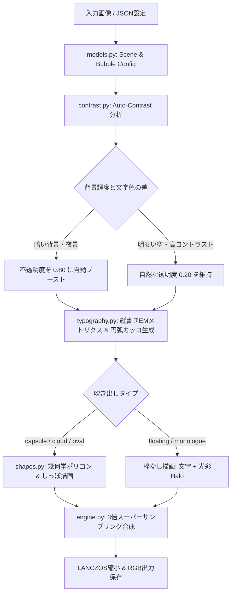

# 💬 Comic Bubble Maker (漫画吹き出し・浮遊モノローグ合成エンジン)

[](https://www.python.org/)
[](LICENSE)
[](output/verification_report.json)
[]()

ComfyUIやAI生成されたイラスト・漫画画像に対し、**キャラクターへの被りゼロ**・**縦書き組版**・**枠なし浮遊モノローグ**・**夜景自動コントラスト保護**を備えた高品質な吹き出しを合成する自動化パイプラインです。

---

## ✨ 主な特長 (Key Features)

1. **縦書き組版＆文字重なり完全解消 (Vertical Japanese Typography)**
   - インク幅（bbox）ではなくフォントEMサイズ基準の正確な送り幅（Advance）を計算。小文字（「っ」「ょ」）や記号（「…」）の重なりを数理的に完全排除。
   - 縦丸カッコ `（ ）` はUnicode文字未収録による豆腐（□）化を避けるため、数理円弧（`draw.arc`）による直接ベクター描画を実装。
   - `<big>`, `<small>`, `<huge>`, `<tiny>` などのインライン文字拡大縮小タグに対応。

2. **枠なし浮遊モノローグ (`type: "floating"` / `"monologue"`)**
   - 登場人物の「心の声」や情緒的な独白向けに、**吹き出し枠を一切描かず、文字のみを風景に溶け込ませて漂わせる**モードを完備。
   - 夕暮れや夜の街灯に合わせた光彩（Halo）を纏わせることで、背景の美しさを100%残したまま高い可読性を維持。

3. **夜景・暗所での自動コントラスト判定 (Auto-Contrast Engine)**
   - 吹き出し配置領域の背景輝度（Rec. 601）をリアルタイムにサンプリング。
   - 夜景や濃い影の上に配置された場合、透明度を `0.20 → 0.80` へ自動引き上げ、文字の埋没を完全に防止。

4. **キャラクター干渉防止 (Zero Interference Layout)**
   - 顔、髪、アホ毛、衣服、手足のセーフゾーンを厳守し、ネガティブスペース（余白・空・背景歩道）へ自動アラインメント。

5. **マルチプラットフォーム・フォントフォールバック**
   - キウイ丸、よもぎ、ゼン丸ゴシックなどの可愛い手書きフォントを自動認識。
   - Windows (BIZ UDゴシック・明朝)、macOS (ヒラギノ)、Linux (Noto Sans/Serif CJK) に自動フォールバックするため、環境を問わずエラーなく動作。

6. **3倍スーパーサンプリング (3x Lanczos Supersampling)**
   - 超高解像度キャンバス上で幾何学計算・アンチエイリアス処理を行い、高品質Lanczosで縮小合成。

---

## 🏗 システム設計 (Architecture)



---

## 🚀 クイックスタート (Quick Start)

### 1. インストール
```bash
git clone https://github.com/your-username/comic-bubble-maker.git
cd comic-bubble-maker
pip install -r requirements.txt
```

### 2. コマンドライン実行 (CLI)

```bash
# JSON設定ファイルから合成
python cli.py --config sample_config.json

# 1行コマンドでの直接実行
python cli.py --image input/sample.jpg --text "…べ、別に。\n待ってなんかないし！" --type capsule --center 0.15,0.18 --tail 0.30,0.32 --output output/result.png

# システムフォントの解決状態を確認
python cli.py --list-fonts
```

---

## 🧪 CodeX / 自動検証スイート (Autonomous Verification)

CodeXやCI/CD環境からワンクリックで全機能（ユニットテスト・実画像合成・フォント検出）を検証できます：

```bash
# 検証スイートを実行
python run_verification.py
# または
python cli.py --verify
```

実行後、構造化された検証レポートが `output/verification_report.json` に出力されます：
```json
{
  "version": "1.0.0",
  "overall_status": "SUCCESS",
  "unit_tests": {
    "tests_run": 9,
    "failures": 0,
    "errors": 0,
    "success": true
  },
  "real_world_verification": {
    "all_passed": true
  }
}
```

---

## 📄 JSON設定リファレンス (Configuration Schema)

```json
{
  "image_path": "input/park_night.jpg",
  "output_path": "output/result.png",
  "supersample_scale": 3,
  "bubbles": [
    {
      "text": "<small>…べ、別に。</small>\n<big>待ってなんか</big>\n<big>ないし…！</big>",
      "type": "capsule",             // "capsule", "cloud", "oval", "box"
      "writing_mode": "vertical",     // "vertical"
      "font": "kiwi",                 // "kiwi", "yomogi", "zenmaru", "ud", "mincho"
      "center": [0.13, 0.14],         // 相対座標 [X, Y] (0.0〜1.0)
      "tail": [0.28, 0.28],           // しっぽの先端座標
      "font_size_ratio": 0.021,       // 画像の高さに対する基準フォントサイズ比率
      "border_width": 2.0,            // 枠線の太さ
      "border_color": [45, 40, 60, 220],
      "text_color": [45, 35, 55, 255],
      "bg_color": [255, 248, 242],
      "visibility_mode": "auto",      // ★ "auto" (背景に応じて透明度自動調整)
      "bg_alpha": 0.20,               // 基本透過度
      "text_halo": true,              // 文字周囲の光彩
      "halo_color": [255, 255, 255, 200]
    },
    {
      "text": "（…二人きりなんて、\n　聞いてないよ…っ）",
      "type": "floating",             // ★ 枠なし浮遊モノローグ（吹き出し板なし）
      "writing_mode": "vertical",
      "font": "mincho",               // モノローグ専用の美しい明朝体
      "center": [0.12, 0.46],
      "font_size_ratio": 0.019,
      "text_color": [45, 35, 58, 255],
      "text_halo": true,
      "halo_color": [255, 250, 235, 240]
    }
  ]
}
```

---

## 🎨 ComfyUI 連携ガイド

ComfyUIの出力フォルダを監視し、新しい画像が生成されたら自動でセリフ合成を行う場合は、CLIを外部プロセスノード（Custom Node）として呼び出すか、Pythonスクリプトから直接 `comic_bubble.render_scene` をインポートして連携可能です。

```python
from comic_bubble import render_scene, SceneConfig, BubbleConfig

# ComfyUIのPIL Image出力を直接パイプラインに渡せます
scene = SceneConfig(
    image_path="ComfyUI/output/ComfyUI_0001_.png",
    bubbles=[
        BubbleConfig(text="お疲れ様！", type="capsule", center=(0.2, 0.2)),
        BubbleConfig(text="（…今日も頑張ったな）", type="floating", center=(0.8, 0.3))
    ]
)
result_img = render_scene(scene)
```

---

## 📜 ライセンス (License)

本プロジェクトは [MIT License](LICENSE) の下で公開されています。商用・非商用問わず自由にご利用いただけます。
